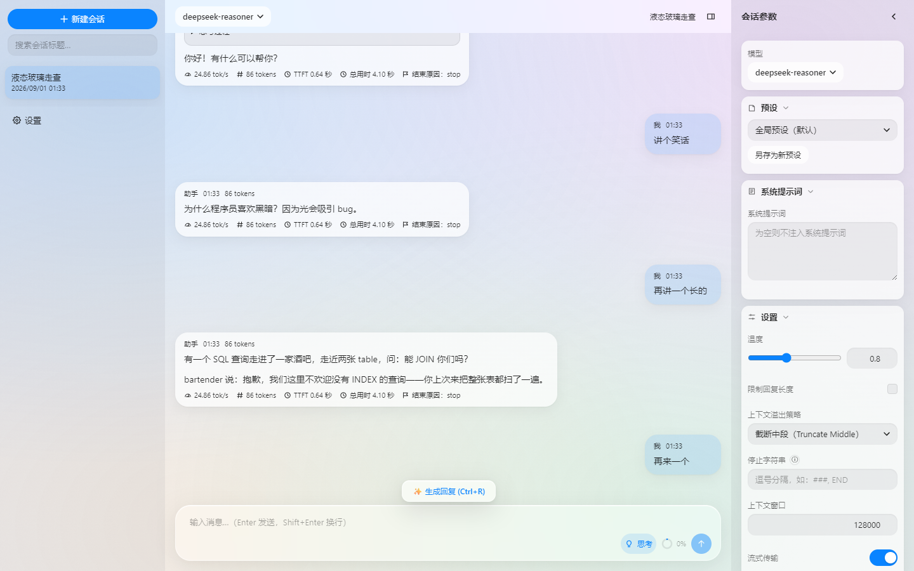
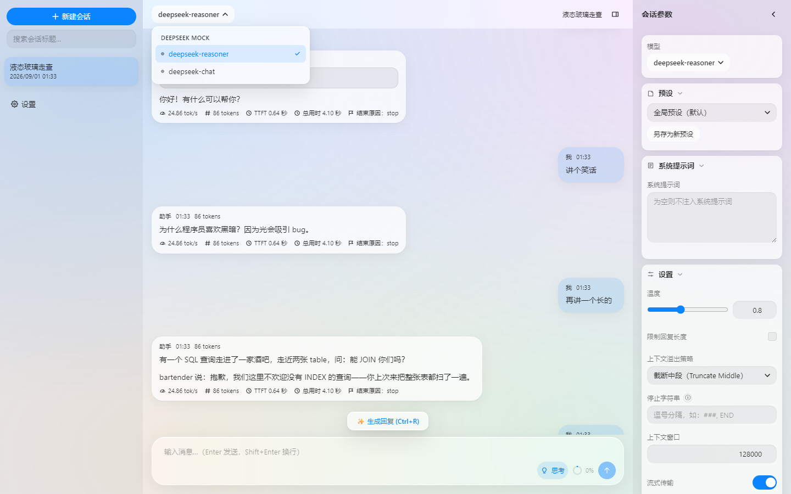
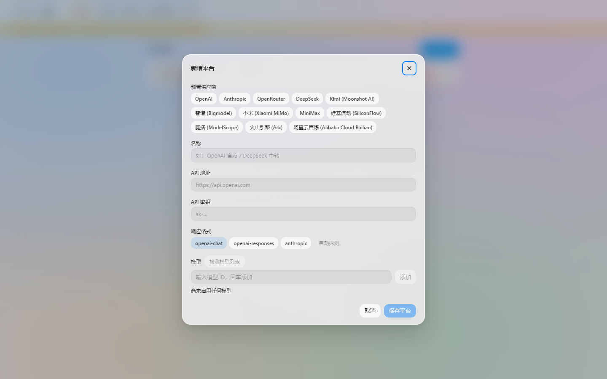

# Easy WebUI

**English** | [简体中文](./README.zh-CN.md)

A lightweight, **local-first** multi-provider LLM chat client for the desktop, built with Electron + React 18 + TypeScript. All data lives on your machine; API keys are encrypted at rest and never leave the main process.

## Download

Get the latest release from [GitHub Releases](https://github.com/ryanlew17/Easy-WebUI/releases):

- **Setup.exe** — installer; supports in-app online updates (Settings → About).
- **Portable.exe** — no install needed; keeps all data in a `data/` folder next to the exe.

No Electron handy? `npm install && npm run dev` starts a **pure-browser preview** powered by a localStorage mock bridge — the full UI flow works without any native modules.

## Features

- **12 preset providers** out of the box: OpenAI, Anthropic, OpenRouter, DeepSeek, Kimi (Moonshot AI), 智谱 (Bigmodel), 小米 (Xiaomi MiMo), MiniMax, 硅基流动 (SiliconFlow), 魔搭 (ModelScope), 火山引擎 (Ark), 阿里云百炼 (Alibaba Cloud Bailian) — plus fully custom base URL / API format (`openai-chat` / `openai-responses` / `anthropic`) with auto-detection.
- **Streaming chat with reasoning display** — SSE streaming, incremental Markdown rendering (GFM tables, code highlighting), collapsible reasoning blocks for models like DeepSeek. Stop / regenerate supported.
- **LM Studio-style parameter presets** — a global preset plus your own presets, with per-conversation overrides and one-click reset; system prompt, temperature, response-length limit, context-overflow strategy, stop strings, sampling toggles, and JSON-Schema structured output.
- **Liquid-glass dual-theme UI** — light / dark / system themes with reduced-motion and reduced-transparency fallbacks.
- **Appearance customization** — UI zoom (50%–250%), custom interface & code fonts, independent interface and code-block font sizes, and an independent code-block background. Everything applies instantly with no flash on startup.
- **Encrypted key storage** — keys are encrypted via Electron `safeStorage` (DPAPI / Keychain / libsecret) with an encrypted fallback for keyring-less systems; the UI only ever sees a `has_key` boolean.
- **Encrypted backup & restore** — one-click zip backups; key-including backups are protected by an independent password. Merge or overwrite restore.
- **Your data, your location** — the portable build keeps data next to the exe; the installed build uses the per-user directory (reinstalling and uninstalling never touch it). A custom location can be picked with automatic migration, and legacy data from older versions is rescued automatically.
- **Online updates** — checks GitHub Releases, auto-downloads with sha512 verification, shows the release summary, and installs with a restart on confirm.
- **Bilingual UI** — 简体中文 / English, with system-locale detection.
- **Model management** — fetch remote model lists, per-model connectivity checks (latency + status), batch "test all".

## Screenshots

| Chat (light, 中文) | Chat (dark, 中文) |
| --- | --- |
|  |  |

| Model picker (liquid-glass blur) | Add provider (12 presets) |
| --- | --- |
|  |  |

More in [docs/screenshots/](./docs/screenshots/) — welcome page, settings, the streaming "thinking…" state, and the multi-line composer with the liquid-glass "Generate Response" pill floating above it, 8 shots in total.

## Data & Privacy

- Conversations, providers and settings live in a local SQLite database (`easyui.db`) — nothing leaves your machine except requests to the LLM providers you configure.
- API keys are **never written in plaintext** and never exported into backups by default; all logs and error messages mask known secrets.
- Where the data lives: portable build → `data/` next to the exe; installed build → `%APPDATA%/easy-webui/data`; custom path via Settings → General → Data storage path (migrated automatically, effective after restart).
- Detail: [docs/design/security.md](./docs/design/security.md), [docs/design/storage.md](./docs/design/storage.md).

## Documentation

- Product scope & roadmap: [docs/prd.md](./docs/prd.md) · [docs/roadmap.md](./docs/roadmap.md)
- Architecture, build & packaging: [docs/architecture.md](./docs/architecture.md)
- Module design snapshots: [docs/design/](./docs/design/README.md)
- Cross-process contracts: [docs/contracts/impl-contract.md](./docs/contracts/impl-contract.md)
- Development commands & agent rules: [AGENTS.md](./AGENTS.md) · testing: [docs/testing.md](./docs/testing.md)
- Release process: [docs/release.md](./docs/release.md)

## License

MIT
