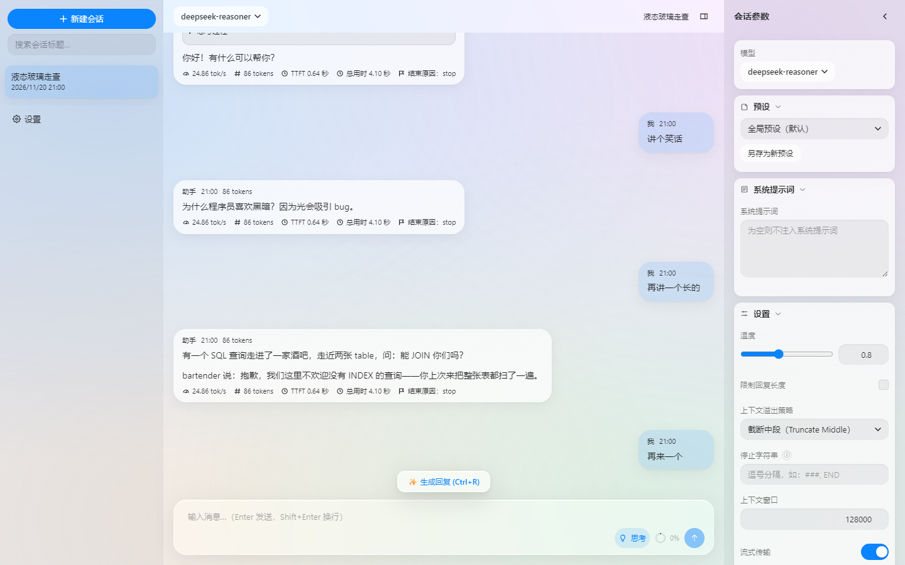
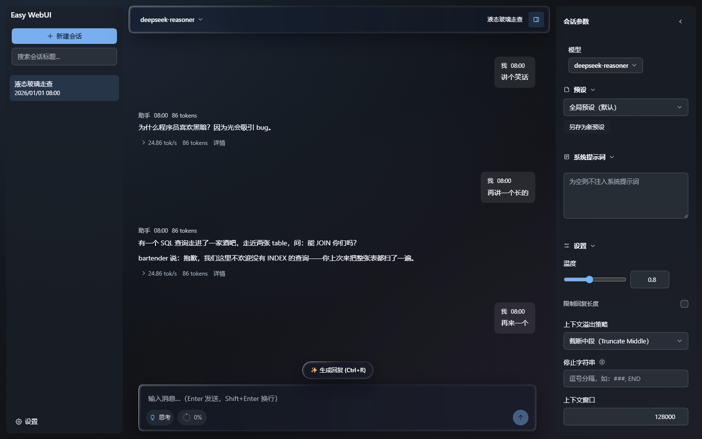
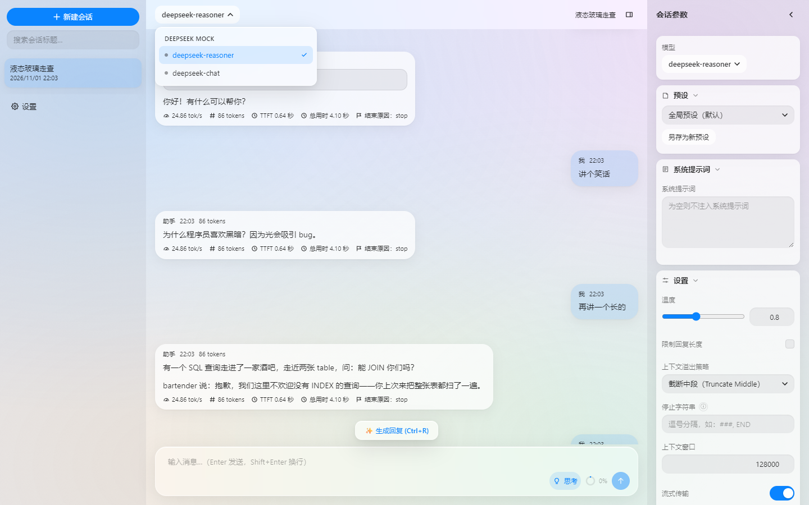
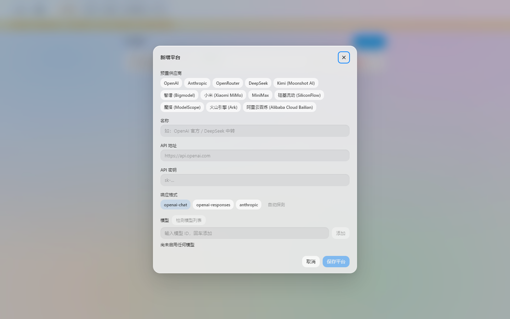

# Easy WebUI

[English](./README.md) | **简体中文**

轻量级、**本地优先**（local-first）的多供应商大模型对话桌面客户端，基于 Electron + React 19 + TypeScript。全部数据保存在本机；API 密钥加密落盘，渲染进程永远接触不到密钥。

## 下载安装

从 [GitHub Releases](https://github.com/ryanlew17/Easy-WebUI/releases) 获取最新版本：

- **Setup.exe** —— 安装版；支持应用内在线升级（设置 → 关于）。
- **Portable.exe** —— 便携版；免安装，全部数据保存在 exe 旁的 `data/` 目录。

没有 Electron 环境也能预览：`npm install && npm run dev` 启动**纯浏览器预览**（localStorage mock 桥），完整走通全部 UI 流程，不依赖任何原生模块。

## 功能特性

- **12 家预置供应商**开箱即用：OpenAI、Anthropic、OpenRouter、DeepSeek、Kimi (Moonshot AI)、智谱 (Bigmodel)、小米 (Xiaomi MiMo)、MiniMax、硅基流动 (SiliconFlow)、魔搭 (ModelScope)、火山引擎 (Ark)、阿里云百炼 (Alibaba Cloud Bailian)——同时支持完全自定义 base_url / 协议格式（`openai-chat` / `openai-responses` / `anthropic`），并可自动探测 OpenAI 与 Anthropic 两种格式。
- **流式对话 + 推理过程展示**——SSE 流式输出、Markdown 增量渲染（GFM 表格、代码高亮），DeepSeek 等模型的推理内容以折叠块展示。支持停止 / 重新生成。
- **LM Studio 风格参数预设**——全局预设之上叠加用户预设，会话级覆盖可一键恢复预设值；涵盖系统提示词、温度、回复长度限制、上下文溢出策略、停止字符串、采样开关与 JSON Schema 结构化输出。
- **液态玻璃双主题 UI**——浅色 / 深色 / 跟随系统，完整支持减弱动效 / 减弱透明度降级。
- **外观自定义**——界面缩放（50%–250%）、自定义界面与代码字体、界面字号与代码块字号独立可调、代码块背景独立设置。全部即时生效，启动无样式闪烁。
- **密钥加密存储**——经 Electron `safeStorage`（DPAPI / Keychain / libsecret）加密，无系统密钥环时有加密回退方案；界面只能看到「是否已设置密钥」。
- **加密备份 / 恢复**——一键 zip 备份；含密钥备份使用独立密码保护。恢复支持合并 / 覆盖两种模式。
- **数据位置自管**——便携版数据固定在 exe 旁；安装版存于用户目录（重装 / 卸载均不丢数据）；支持自选存储路径并自动迁移，旧版本遗留数据自动抢救迁移。
- **在线升级**——检查 GitHub Releases，自动下载并做 sha512 校验，展示版本摘要，确认后安装并重启。
- **中英双语**——简体中文 / English，支持跟随系统语言。
- **模型管理**——拉取远程模型列表、单模型连通性检测（延迟 + 状态）、一键全部检测。

## 截图

| 会话页（浅色） | 会话页（深色） |
| --- | --- |
|  |  |

| 模型选择器（液态玻璃模糊） | 新增平台（12 家预置） |
| --- | --- |
|  |  |

更多见 [docs/screenshots/](./docs/screenshots/)：欢迎页、设置、平台与模型选择、深浅主题会话、流式生成，以及上方浮出「生成回复」液态玻璃胶囊的多行输入坞，共 8 张。

## 数据与隐私

- 会话、供应商与设置全部保存在本地 SQLite 数据库（`easyui.db`）——除了你配置的大模型服务商 API，数据不发往任何地方。
- API 密钥**永不明文落盘**，备份默认不含密钥；日志与错误消息对已知密钥一律脱敏。
- 数据位置：便携版 → exe 旁 `data/`；安装版 → `%APPDATA%/easy-webui/data`；自定义路径：设置 → 通用 → 数据存储路径（自动迁移，重启后生效）。
- 详见 [docs/design/security.md](./docs/design/security.md)、[docs/design/storage.md](./docs/design/storage.md)。

## 开发环境

要求 Node.js `>=26.13.1 <27`。使用 `npm ci` 安装依赖；`engine-strict` 负责 install/ci，统一版本预检同时覆盖 npm 脚本和直接执行的 `scripts/*.mjs` 入口。

## 文档

- [文档地图](./docs/README.md)——产品、架构、模块行为、接口契约与 ADR。
- [开发命令与代理规则](./AGENTS.md)
- [验证与发布流程](./docs/release.md)

## 许可证

MIT
